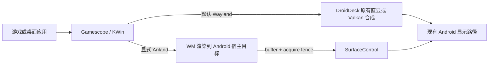

# DroidDeck 的 Anland v5 接入

Gamescope 和 KWin 可以将完整画面直接合成到 DroidDeck 分配的 Android 缓冲区，再由现有 SurfaceControl 路径显示。Android 端在已有 Wayland 事件循环中提供 Anland v5 端点，不需要另外运行 anland daemon 或 consumer。

默认继续使用 DroidDeck 的 Wayland 后端及游戏直显路径。Anland 适合需要 WM 完整合成的场景，能够省去宿主对合成结果的一次图像 blit；游戏原本就能直接提交缓冲区时，没有这次拷贝可省，不能据此推断 Anland 总是更快。



## 启用

需要同时包含本次改动的 APK，以及所选 WM 的新版组件。仅重新编译 APK，已发布的旧 Gamescope/KWin 二进制不会自动获得 Anland 后端。启动脚本会检查组件是否支持该后端，缺失时给出提示。

在 Android 11 及以上，将下列配置加入应用外部文件目录的 `droiddeck-env`，每行一个 `KEY=value`：

```ini
DROIDDECK_GAMESCOPE_BACKEND=anland
DROIDDECK_KWIN_BACKEND=anland
```

两行分别控制 Gaming Mode 的 Gamescope 和桌面的 KWin，可以单独设置。正式应用的路径通常是 `/storage/emulated/0/Android/data/com.droiddeck.launcher/files/droiddeck-env`；带应用 ID 后缀的本地版本使用自己的目录。旧的 `Download/droiddeck-env` 不会被读取。停止当前会话后重新启动，使配置生效。

恢复默认时删除对应配置，或将值改为 `wayland`。只设置 `ANLAND_SOCKET` 不会切换后端。

端点位于 `$XDG_RUNTIME_DIR/anland.sock`，同一时刻接受一个 WM 连接。KWin 仍为桌面应用提供 `wayland-1`。如需指定渲染节点，可设置 `ANLAND_DRM_DEVICE=/dev/dri/renderD…`；KWin 启动器会将其转换为当前版本使用的 `KWIN_RENDER_NODES`。

Anland 模式由 WM 负责整屏画面。桌面的游戏启动器会将窗口和全屏游戏都送入 KWin，并允许窗口游戏使用 GPU WSI。若要另开绕过 WM 的直显会话，需要先退出当前 Anland WM。

## 已接通的服务

| 功能 | 当前行为 |
| --- | --- |
| 显示 | 三个宿主目标，RGBA8888，整桌面提交；resize/断连后使用新 buffer 池 |
| 同步 | producer acquire fence 传给 SurfaceControl；Android release fence 成功完成后才允许复用对应目标 |
| 输入 | 键盘、绝对/相对指针、按钮、滚轮、多点触摸及取消 |
| 指针捕获 | WM 的捕获请求转到 DroidDeck 现有 Android 输入接口 |
| 剪贴板 | Android 与 WM 双向文本传输，支持分段收发和有界队列 |
| 文本输入 | UTF-8 提交；删除操作通过有界按键序列兼容；v5 不承载原生 preedit 状态 |
| 刷新率 | 宿主的刷新率变化通知 WM，尺寸变化触发会话重建 |
| 调度 | WM 前台进程请求接入 DroidDeck 现有进程通知接口 |
| 音频 | 继续由 DroidDeck 原有音频路径处理，启动器关闭 Anland 自带的音频引擎 |
| 摄像头等资源 | 暂不提供，明确回复资源不可用；不会创建摄像头设备 |

发送队列满、消息无效或连接中断时，会关闭会话并退休目标池。正在等待 Android 异步回调的旧池保留到回调结束，不能靠重新连接提前复用。释放 fence 错误或无法证明释放完成时，目标会被隔离。静态桌面持有合法目标不会因没有新帧而超时。

## 适用范围与限制

- 需要 Android 的 SurfaceControl 接口（Android 10 及以上）。首版只接受能确认布局的 QTI 线性 RGBA dma-buf；不把未知 gralloc 布局猜成线性。不满足时会拒绝 Anland 会话，可切回默认 Wayland。
- 这条路径显示完整的 WM 合成结果，不会为每个 Linux 窗口创建 Android Surface。
- WM 自己的合成和特效仍由 WM 负责。DroidDeck 宿主的后处理、插帧、HDR 和 Cardboard 渲染不经过这条外部目标路径；需要这些功能时使用默认后端。
- KWin 导出 EGL native fence，无法导出时同步完成 GPU 工作。Gamescope 目前保留同步基线：等待 Vulkan 合成完成后提交，还会逐帧导入目标。宿主没有额外图像 blit，不代表整个路径没有 GPU 等待或导入开销。
- Android 目标就绪、提交次数、WM 渲染吞吐与屏幕实际呈现是不同指标。Anland ACK 不作为物理 scanout 或硬件 VSync 时间。

## 构建与源码

`upstream/` 固定导入 [Anland](https://github.com/sjszero/anland) 的公共 producer 和两个 WM 后端，revision 与每个文件的 SHA256 见 [SOURCE.json](upstream/SOURCE.json)，许可证保留在 [LICENSE](upstream/LICENSE)。Gamescope 注册补丁针对 DroidDeck 已打补丁的 3.16.29 适配，并移除了后端临时的 X11 指针诊断；KWin 接入要求显式 `--anland`。其余协议、提交及输入公共实现保持唯一来源。

已有构建入口会自动加入后端：

- `tools/gamescope/build-in-arch.sh`：在 Arch Linux ARM 构建环境中，先应用 DroidDeck 原补丁，再加入 Anland。
- `tools/desktop-kde/build-kwin.sh OUT`：在原有 KWin 6.8.2 构建流程中加入 Anland，同时记录源清单摘要。
- APK 原生构建直接编入 `anland_server.c` 和 `anland_bridge.c`。组件工作流已加入 `tools/anland/**` 触发条件；发布组件的版本号与下载摘要需在真正生成新产物后更新。

离线检查已导入的源文件：

```sh
python3 tools/anland/stage.py verify
```

`stage.py gamescope SOURCE` / `stage.py kwin SOURCE` 面向已经应用 DroidDeck 原补丁的源码目录。它会先校验源摘要，再以 `--fuzz=0` 检查注册补丁，拒绝覆盖已经存在的 Anland 后端。

## 日志与本地检查

宿主日志使用 DroidDeck 原有日志收集入口，标签为 `anland`，可以随 **Share logs** 一起导出。连接、目标池、失败和退休均有记录；每十秒汇总一次 `submitted`、`submit_fps`、`host_blits` 与目标数，避免逐帧刷屏。`submit_fps` 表示宿主提交频率，不是游戏渲染帧率或屏幕实际显示帧率。

本机有 C 编译器和 `wayland-server` 开发文件时，可以运行：

```sh
python3 -m unittest discover -s tools/tests -p 'test_anland*.py' -v
```

协议测试使用真正的公共 producer 与 Unix FD 传输。显示生命周期测试编译实际 bridge、server 和 SurfaceControl 管理代码，仅模拟 Android API。它们覆盖背压、分段传输、输入、resize、旧池退休和释放回调归属；不能代替 Android APK 构建、真实驱动导入及设备上的画面和性能测试。
